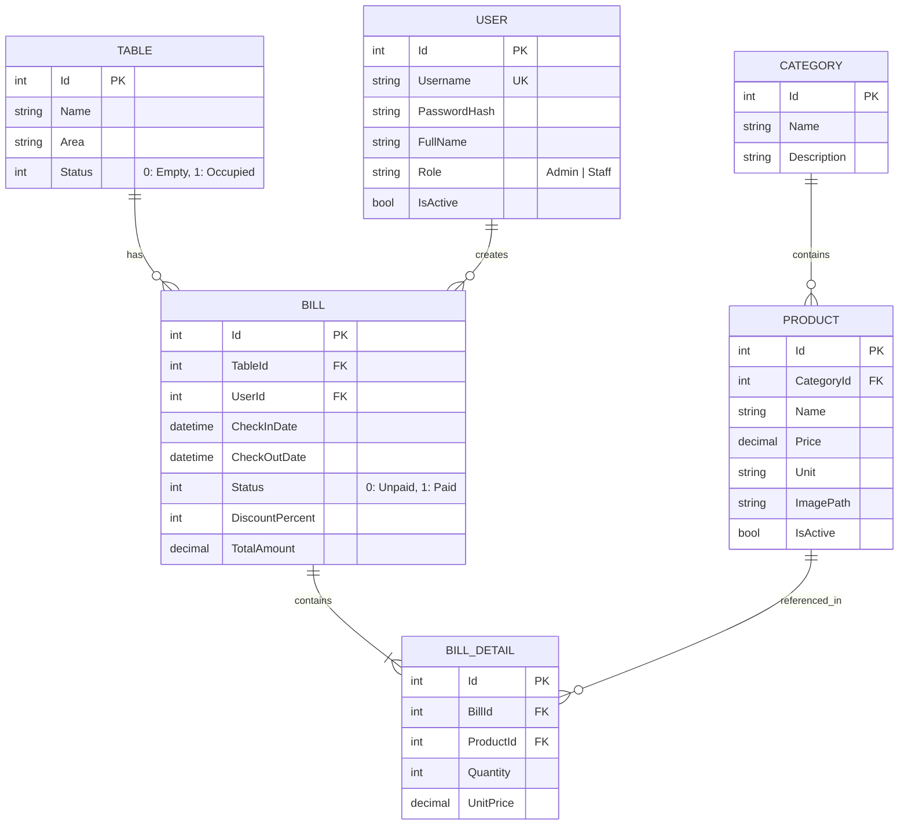

# Tài liệu Thiết kế Hệ thống Quản lý Quán Cà phê (Coffee Shop Management System)

- **Môn học:** Lập trình trên hệ điều hành Windows
- **Nền tảng:** C# .NET 8.0 Windows Forms
- **ORM:** Entity Framework Core 8 (Code-First Migrations)
- **Hệ quản trị CSDL:** Microsoft SQL Server (LocalDB / SQL Express)
- **Kiến trúc:** Single Project phân chia thư mục nghiệp vụ (Models, Data, Services, Forms, Utils)
- **Ngày lập:** 2026-10-30

---

## 1. Mục tiêu và Phạm vi Dự án

### 1.1 Mục tiêu
Xây dựng ứng dụng desktop Windows Forms hiện đại, ổn định, phục vụ quản lý bán hàng tại quán cà phê. Áp dụng chuẩn kỹ thuật .NET 8, Dependency Injection, Entity Framework Core Code-First, bảo mật mật khẩu và xuất báo cáo.

### 1.2 Phân hệ Chức năng
1. **Quản trị người dùng & Phân quyền:**
   - Đăng nhập, đổi mật khẩu.
   - Phân quyền: `Admin` (toàn quyền hệ thống), `Staff` (chỉ thu ngân / bán hàng).
   - Mã hóa mật khẩu: `BCrypt.Net-Next`.

2. **Sơ đồ bàn & POS Bán hàng:**
   - Trực quan hóa danh sách bàn theo khu vực (Tầng 1, Sân vườn, v.v.).
   - Trạng thái bàn: Bàn trống (màu xanh), Bàn có khách (màu đỏ).
   - Chọn bàn, mở hóa đơn, chọn món, cập nhật số lượng món.
   - Đổi bàn (chuyển sang bàn trống), Gộp bàn (chuyển món giữa 2 bàn đang có khách).

3. **Quản lý Thực đơn & Danh mục:**
   - CRUD danh mục đồ uống / món ăn.
   - CRUD món: Tên món, đơn vị tính, đơn giá, ảnh đại diện, trạng thái phục vụ.

4. **Quản lý Bàn & Khu vực:**
   - Thêm, sửa, xóa bàn và phân loại khu vực.

5. **Thanh toán & In Hóa đơn:**
   - Tính tổng tiền món, nhập % chiết khấu (giảm giá), tính thành tiền cuối cùng.
   - Cập nhật trạng thái hóa đơn sang "Đã thanh toán", giải phóng bàn về trạng thái "Trống".
   - In hóa đơn K80 hoặc A5 bằng `PrintDocument` tiêu chuẩn, có hộp thoại `PrintPreviewDialog`.

6. **Báo cáo & Thống kê:**
   - Thống kê doanh thu theo khoảng thời gian (Từ ngày - Đến ngày).
   - Bảng tổng hợp số hóa đơn, doanh thu, top món bán chạy nhất.
   - Xuất dữ liệu báo cáo ra file Excel `.xlsx` bằng `ClosedXML`.

---

## 2. Kiến trúc Kỹ thuật & Cấu trúc Dự án

### 2.1 Công nghệ và Thư viện NuGet
* `Microsoft.EntityFrameworkCore.SqlServer` (8.0.x)
* `Microsoft.EntityFrameworkCore.Tools` (8.0.x)
* `Microsoft.EntityFrameworkCore.Design` (8.0.x)
* `Microsoft.Extensions.Hosting` (8.0.x)
* `Microsoft.Extensions.DependencyInjection` (8.0.x)
* `Microsoft.Extensions.Configuration.Json` (8.0.x)
* `BCrypt.Net-Next` (4.0.3)
* `ClosedXML` (0.102.x)

### 2.2 Cấu trúc Thư mục

```
DoAnQuanLyCF/
├── Program.cs                     # Điểm khởi chạy, cấu hình DI Container
├── appsettings.json               # Cấu hình chuỗi kết nối và thông tin quán
├── Models/                        # Entities ánh xạ bảng CSDL
│   ├── User.cs
│   ├── Table.cs
│   ├── Category.cs
│   ├── Product.cs
│   ├── Bill.cs
│   └── BillDetail.cs
├── Data/                          # EF Core DbContext & Seed data
│   ├── AppDbContext.cs
│   ├── AppDbContextFactory.cs
│   └── DbInitializer.cs
├── Migrations/                    # Lịch sử EF Core Migrations
├── Services/                      # Tầng xử lý nghiệp vụ
│   ├── Interfaces/
│   │   ├── IAuthService.cs
│   │   ├── ITableService.cs
│   │   ├── IProductService.cs
│   │   ├── IBillService.cs
│   │   └── IReportService.cs
│   └── Implementations/
│       ├── AuthService.cs
│       ├── TableService.cs
│       ├── ProductService.cs
│       ├── BillService.cs
│       └── ReportService.cs
├── Forms/                         # WinForms giao diện người dùng
│   ├── FrmLogin.cs
│   ├── FrmMain.cs                 # Giao diện chính POS & Sơ đồ bàn
│   ├── FrmTableManager.cs         # Quản lý bàn
│   ├── FrmCategoryProduct.cs      # Quản lý món & danh mục
│   ├── FrmPayment.cs              # Hộp thoại thanh toán
│   ├── FrmUserManager.cs          # Quản lý tài khoản nhân viên
│   └── FrmReport.cs               # Báo cáo doanh thu & xuất Excel
├── Components/                    # Custom UserControls
│   ├── UcTableCard.cs             # Nút hiển thị bàn trực quan
│   └── RjButton.cs                # Nút bấm bo góc hiện đại
└── Utils/                         # Tiện ích bổ trợ
    ├── PasswordHelper.cs          # Hash và verify mật khẩu BCrypt
    ├── BillPrinter.cs             # In hóa đơn PrintDocument
    └── ExcelExporter.cs           # Xuất Excel ClosedXML
```

---

## 3. Thiết kế Cơ sở Dữ liệu (Code-First)

### 3.1 Sơ đồ Quan hệ Thực thể (ERD)



### 3.2 Quy ước Ràng buộc Khóa Ngoại
* `Bill` -> `Table`: `OnDelete(DeleteBehavior.Restrict)`. Giữ lịch sử hóa đơn kể cả khi bàn bị điều chỉnh.
* `BillDetail` -> `Product`: `OnDelete(DeleteBehavior.Restrict)`.
* `Bill` -> `BillDetail`: `OnDelete(DeleteBehavior.Cascade)`. Khi xóa Bill thì chi tiết bị xóa theo.

---

## 4. Tiêu chuẩn Thiết kế UI Craft & Chống "AI Slop" (UI Guidelines)

### 4.1 Bộ màu chủ đạo (Espresso Warm Palette)
Loại bỏ hoàn toàn màu xám Windows 98 mặc định và các màu thuần chói mắt (`#00FF00`, `#FF0000`). Sử dụng hệ màu cà phê ấm áp, tinh tế:
* **Nền chính (Canvas):** `#F7F5F2` (Warm Off-White, dịu mắt).
* **Nền thẻ/Panel (Surface):** `#FFFFFF` viền mảnh `#E8E2D9` (1px).
* **Màu thương hiệu (Primary / Brand):** `#3D2817` (Deep Espresso).
* **Màu điểm nhấn (Accent):** `#C68B59` (Warm Caramel / Amber).
* **Màu chữ chính (Text Primary):** `#2B2520` (Dark Roast, độ tương phản cao, không dùng `#000000` thuần).
* **Màu chữ phụ (Text Muted):** `#7D756D`.
* **Trạng thái Bàn trống:** `#4E7C59` (Sage Green) - dịu nhẹ, thanh lịch.
* **Trạng thái Bàn có khách:** `#C85A32` (Terracotta / Brick Red) - rõ ràng nhưng không gắt.

### 4.2 Typography & Tỷ lệ Không gian
* **Font chữ đồng nhất:** `Segoe UI` trên toàn bộ Form (Cấm dùng `Microsoft Sans Serif 8.25pt` mặc định).
  * Tiêu đề lớn (Form/Header): 16pt - 18pt SemiBold.
  * Tiêu đề phân nhóm: 12pt - 14pt SemiBold.
  * Nội dung / Nút bấm / Ô nhập liệu: 10pt Regular.
  * Nhãn phụ / Ghi chú: 9pt Regular.
* **Lưới khoảng cách 8px:** Margin và Padding tuân thủ bội số 8px (8px, 16px, 24px) tạo nhịp thở thoáng đãng.
* **Bảng dữ liệu (DataGridView):**
  * Chiều cao hàng (RowTemplate.Height): 38px (thay vì 22px chật chội mặc định).
  * Chiều cao tiêu đề (ColumnHeadersHeight): 40px, nền `#ECE7E1`, chữ đậm.
  * Màu xen kẽ dòng: `#FAFAF9` và `#FFFFFF`. Bỏ đường kẻ lưới thô (`CellBorderStyle.SingleHorizontal`).

### 4.3 Những điều cấm triệt để (Anti-AI Slop Rules)
1. **Cấm viền 3D nổi thời cũ:** Tuyệt đối không dùng `BorderStyle.Fixed3D`. Dùng `BorderStyle.None` hoặc viền phẳng 1px.
2. **Cấm lạm dụng Icon Emoji:** Không dùng emoji rải rác làm icon nút (như ☕, 🪑, ❌, 💰). Sử dụng nhãn văn bản với động từ hành động cụ thể hoặc icon vẽ phẳng chuẩn.
3. **Cấm nút bấm cầu vồng ngẫu nhiên:** Không dùng mỗi nút một màu lòe loẹt. Chỉ có 2 cấp nút: Nút chính (Solid Espresso/Caramel) và Nút phụ (Ghost/Outlined).
4. **Cấm MessageBox cụt ngủn:** Thông báo lỗi và xác nhận phải ghi rõ vấn đề và hành động khắc phục, không dùng tiếng Anh lẫn tiếng Việt lộn xộn.

---

## 5. Kế hoạch Triển khai Chi tiết

1. **Giai đoạn 1: Khởi tạo Project & Thư viện**
   - Tạo WinForms .NET 8 Project (`dotnet new winforms`).
   - Cài đặt đầy đủ gói NuGet.
   - Tạo file `appsettings.json` cấu hình kết nối LocalDB/SQL Express.
   - Cấu hình DI Container tại `Program.cs`.

2. **Giai đoạn 2: Tầng Dữ liệu & Migrations**
   - Viết các class Entities trong `Models/`.
   - Viết `AppDbContext` kèm Fluent API cấu hình quan hệ, index.
   - Viết `DbInitializer` tạo tài khoản admin/staff mặc định, danh mục và bàn mẫu.
   - Chạy lệnh `dotnet ef migrations add InitialCreate` và `dotnet ef database update`.

3. **Giai đoạn 3: Tầng Nghiệp vụ & Tiện ích (Services & Utils)**
   - Cài đặt `PasswordHelper` với BCrypt.
   - Viết `AuthService`, `TableService`, `ProductService`, `BillService`, `ReportService`.
   - Viết `BillPrinter` (vẽ bill bằng GDI+ / PrintDocument).
   - Viết `ExcelExporter` (xuất DataGridView ra file Excel qua ClosedXML).

4. **Giai đoạn 4: Thiết kế Giao diện WinForms**
   - Xây dựng UserControl `UcTableCard` và `RjButton`.
   - Thiết kế `FrmLogin` đăng nhập và kiểm tra quyền.
   - Thiết kế `FrmMain` với bố cục 3 vùng: Menu bên trái, Sơ đồ bàn trung tâm, Chi tiết hóa đơn bên phải.
   - Thiết kế form popup gọi món, chuyển/gộp bàn, thanh toán.
   - Thiết kế các form quản trị: `FrmCategoryProduct`, `FrmTableManager`, `FrmUserManager`, `FrmReport`.

5. **Giai đoạn 5: Kiểm thử & Hoàn thiện**
   - Kiểm thử luồng bán hàng trọn vẹn: Đặt bàn -> Thêm món -> Chuyển/gộp bàn -> Thanh toán -> In bill.
   - Kiểm thử phân quyền: Đăng nhập Staff không mở được trang Quản trị và Báo cáo.
   - Kiểm tra xuất báo cáo doanh thu ra Excel.

