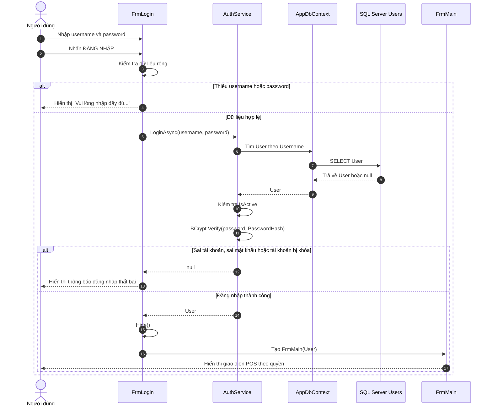
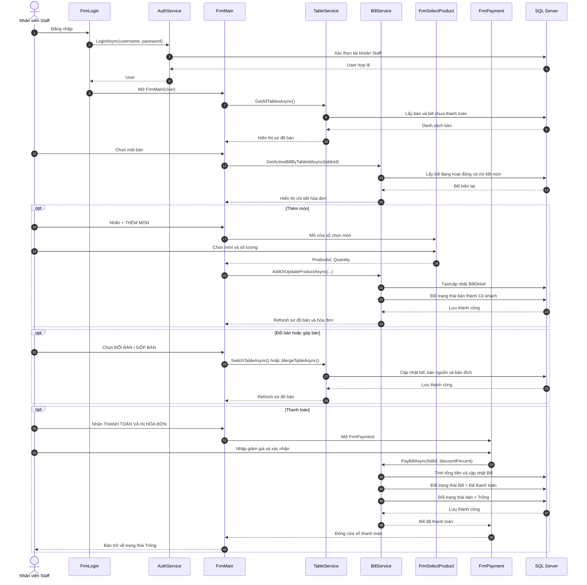
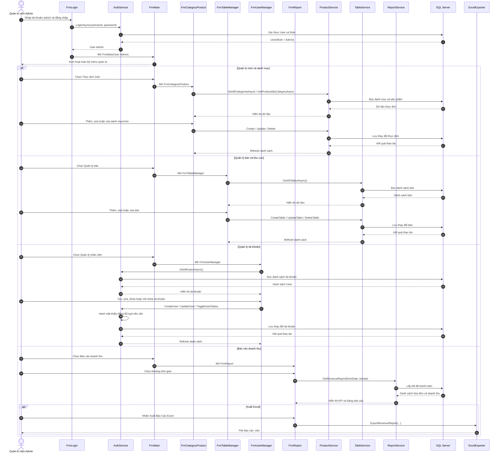

# Sơ đồ UML hệ thống quản lý quán cà phê

> Các sơ đồ dưới đây được xây dựng theo tài liệu thiết kế và luồng xử lý hiện tại của project `CoffeeShopManagement`.

## 1. Use Case Diagram

### Phân quyền chính

| Actor | Quyền sử dụng |
|---|---|
| `Staff` | Đăng nhập, xem bàn, chọn bàn, thêm món, đổi/gộp bàn, thanh toán và in hóa đơn |
| `Admin` | Toàn bộ quyền của Staff, đồng thời quản lý món, danh mục, bàn, tài khoản và báo cáo |

---

## 2. Sequence Diagram đăng nhập

---

## 3. Sequence Diagram Staff

---

## 4. Sequence Diagram Admin

---

## Ghi chú triển khai

- `FrmLogin` gọi `AuthService.LoginAsync()` để xác thực tài khoản.
- `BCrypt.Net-Next` chỉ dùng để kiểm tra mật khẩu với `PasswordHash`, không lưu mật khẩu dạng rõ.
- `FrmMain` là màn hình POS dùng chung cho Admin và Staff.
- `Staff` bị vô hiệu hóa các menu quản trị trong `FrmMain`.
- `Admin` có thể truy cập `FrmCategoryProduct`, `FrmTableManager`, `FrmUserManager` và `FrmReport`.
- `DbInitializer` gọi `context.Database.Migrate()` khi ứng dụng khởi động để áp dụng migration trước khi seed dữ liệu mẫu.
